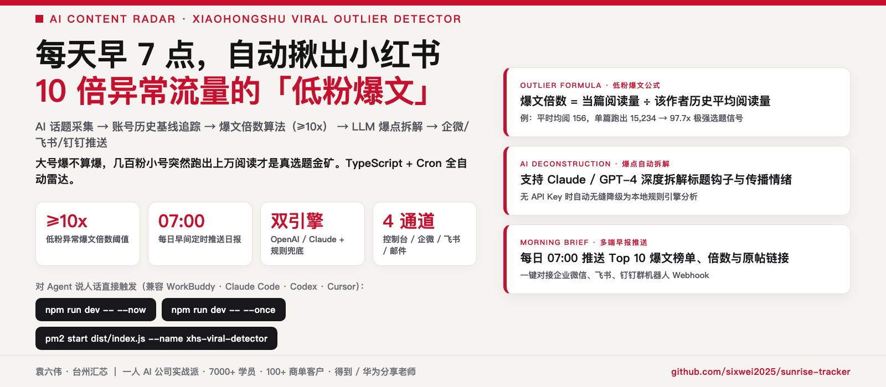
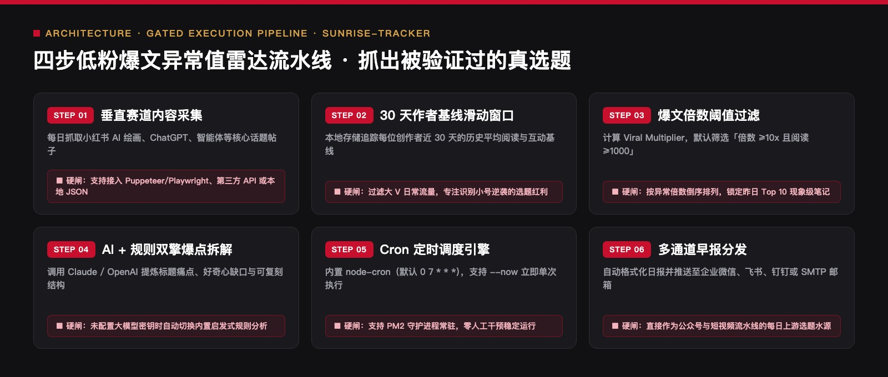

<div align="center">



# Sunrise Tracker · 低粉爆文晨间雷达
### `sunrise-tracker` · 每天早 7 点自动捕猎小红书 AI 赛道「低粉高赞异常值」并拆解选题公式

[](https://agentskills.io)
[](#一核心算法为什么只盯低粉爆文异常值)
[](#四环境变量与多端推送配置)
[](LICENSE)

> 🔴 **作者：袁六伟 · 台州汇芯**｜一人 AI 公司创业者，学员 7000+，客户 100+，得到 / 华为分享老师  
> 📮 更多 AI 工具实测与自动化实战，关注 **公众号 / 视频号：袁六伟**

**大 V 发什么都几千赞，抄他的选题你根本跑不出来；真正值得跟进的，是「只有几百粉丝的素人账号，突然爆出上万阅读」的异常值（Outlier）。**  
`Sunrise Tracker` 是一套专为内容创作者与一人 AI 公司打造的 **每日晨间爆款选题雷达**：每天早上 `07:00` 准时扫描小红书 AI 赛道，用 **10 倍异常流量公式** 过滤掉头部大 V 的粉丝惯性噪音，锁定过去 24 小时真正靠「选题切口 + 情绪共鸣」跑出来的低粉爆文，自动提炼 **可迁移的二创标题与脚本钩子**，推送到你的飞书、企业微信、钉钉或邮箱。

```bash
# 克隆仓库并安装依赖
git clone https://github.com/sixwei2025/sunrise-tracker.git
cd sunrise-tracker && npm install

# 一键试跑今日低粉爆文晨报（默认内置高拟真 Mock 数据，开箱即看）
npm run run-now
```

[为什么只盯低粉爆文](#一核心算法为什么只盯低粉爆文异常值) · [四步雷达架构](#二四步自动化雷达流水线) · [晨报输出预览](#三每日早-7-点晨报真实输出预览) · [多端推送配置](#四环境变量与多端推送配置) · [接入真实数据源与 PM2 部署](#五接入真实爬虫数据源与-pm2-守护进程)

</div>

---

## 一、核心算法：为什么只盯「低粉爆文」异常值？

在算法推荐平台上，判断一个选题本身有没有爆发力，绝对不能只看总点赞数，而要看 **爆款乘数（Viral Multiplier）**：

$$\text{Viral Multiplier（爆款倍数）} = \frac{\text{单篇笔记曝光/互动量}}{\text{该博主近 30 天日常平均互动量}}$$

| 指标维度 | 头部大 V 的普通笔记（假爆款） | 素人低粉爆文（Sunrise Tracker 锁定目标） |
| :--- | :--- | :--- |
| **博主粉丝量** | `100,000+` 粉丝 | **`< 5,000` 粉丝**（冷启动或腰部以下） |
| **日常平均表现** | 平时发篇水文也有 `5,000` 阅读 | 平时每篇只有 `200–500` 阅读 |
| **本篇突发表现** | `8,000` 阅读（仅 `1.6x`，纯靠粉丝基数） | **`15,000+` 阅读（`≥ 10x ~ 50x` 异常爆表！）** |
| **对你的参考价值** | ❌ 毫无参考价值，你发同款必死 | ✅ **选题切口直接踩中算法推荐池，普通人改写即爆** |

### 三重硬核过滤门闸（`src/services/viral-detector.ts`）
1. **赛道关键词相关性**：精准锁定 `AI 工具 / 智能体 / Claude / DeepSeek / 自动化办公 / 一人公司` 等高价值标签。
2. **低粉门槛**：默认只保留 `authorFollowers <= 5000`（可在 `.env` 自定义）的创作者。
3. **10 倍异常引爆线**：强制要求 `views / authorAvgViews >= 10` 且绝对曝光量 `>= 10,000`。

---

## 二、四步自动化雷达流水线

<p align="center">
  
</p>

1. **Step 1 · 赛道扫描采集（`src/services/xhs-fetcher.ts`）**  
   拉取目标关键词下的最新笔记列表与博主近 30 天历史均值；默认内置开箱即用的演示数据，并提供标准扩展槽供接入真实 API / 爬虫。
2. **Step 2 · 10x 异常值过滤与排序（`src/services/viral-detector.ts`）**  
   剔除高粉账号与平庸笔记，按 **爆款倍数（Viral Multiplier）** 从高到低排出今日 Top N 潜力黑马。
3. **Step 3 · LLM 结构化选题拆解（`src/services/ai-analyzer.ts`）**  
   支持接入 **OpenAI (`gpt-4o-mini`)**、**Claude (`claude-3-5-sonnet`)**，并在无 API Key 时自动优雅降级为 **本地规则拆解引擎（Rule-based Fallback）**，逐篇拆出：
   - **为什么能爆？（流量密码归因）**
   - **黄金前 3 秒视觉/文案钩子**
   - **评论区高频痛点提问（直接拿来做下一篇选题）**
   - **给我方账号的 3 个同款改写选题建议**
4. **Step 4 · 多通道晨间准时投递（`src/services/notifier.ts` + `src/index.ts`）**  
   通过 `node-cron` 每日早 `07:00` 触发，将 Markdown 晨报同步推送到终端、本地归档、企业微信、飞书、钉钉或邮箱。

---

## 三、每日早 7 点晨报真实输出预览

运行 `npm run run-now` 后，系统生成的结构化晨报示例：

```markdown
# 🌅 Sunrise Tracker · 小红书 AI 低粉爆文晨报 (2026-11-12)

> 扫描笔记：50 篇 ｜ 命中「粉丝 < 5000 & 曝光 ≥ 10倍均值」异常爆款：3 篇

---

## 🔥 TOP 1｜爆款倍数：38.5x（日常均值 600 → 本篇 23,100 曝光）
- **原标题**：《把周报丢给 Claude Skill 后，我每天准时 6 点下班》
- **博主画像**：粉丝 1,280 · 职场效率赛道素人
- **互动数据**：👍 点赞 1,840 ｜ ⭐ 收藏 2,610（收藏率高达 11.3%！）｜ 💬 评论 312
- **🎯 爆款归因**：
  1. 强反差痛点场景（写周报加班 vs 6点准时下班）；
  2. 收藏大于点赞（1.4倍），说明给出了极具体的 Prompt/配置截图，读者产生「先存下来以后抄」的强烈冲动。
- **💡 今日可跟进改写方向**：
  - 公众号深文：《别再用网页版聊天框写周报了，我用 1 个本地 Skill 把周报压缩到 40 秒》
  - 短视频口播：《粉丝 1000 的素人靠一条 AI 周报笔记爆了 2 万赞，我把他的提示词扒出来了》
```

---

## 四、环境变量与多端推送配置

复制 `.env.example` 为 `.env` 即可按需开启大模型与推送通道：

```bash
cp .env.example .env
```

| 配置项 | 默认值 | 说明 |
| :--- | :--- | :--- |
| `CRON_SCHEDULE` | `0 7 * * *` | 每日定时执行 Cron 表达式（默认每天早上 07:00） |
| `MAX_FOLLOWERS` | `5000` | 低粉博主粉丝上限阈值 |
| `MIN_VIRAL_MULTIPLIER` | `10` | 最小异常爆款倍数（当前曝光 ÷ 博主日常均曝） |
| `LLM_PROVIDER` | `none` | 可选 `openai` / `anthropic` / `none`（`none` 使用内置零成本规则引擎） |
| `NOTIFY_CHANNELS` | `console,file` | 支持逗号分隔多通道：`console,file,wecom,feishu,dingtalk,email` |
| `FEISHU_WEBHOOK_URL` | 空 | 飞书自定义机器人 Webhook 地址 |
| `WECOM_WEBHOOK_URL` | 空 | 企业微信群机器人 Webhook 地址 |

---

## 五、接入真实爬虫数据源与 PM2 守护进程

### 1. 接入你自己的小红书数据源
打开 [`src/services/xhs-fetcher.ts`](src/services/xhs-fetcher.ts)，在数据采集服务中填入你的第三方数据接口（如 TikHub / 亮数据 / 自建 Playwright MCP 服务），并在 `.env` 中设置 `USE_MOCK_DATA=false` 即可无缝切换。

### 2. 使用 PM2 挂载后台长期运行

```bash
# 立即试跑一次验证推送配置
npm run run-now

# 编译 TypeScript 并使用 PM2 启动后台定时守护进程（每天早 7 点自动推送）
npm run build
npx pm2 start dist/index.js --name "sunrise-tracker"
npx pm2 save
```

---

## 六、仓库目录结构

```text
sunrise-tracker/
├── README.md                         # 仓库详情页与算法说明
├── QUICKSTART.md                     # 快速上手手册
├── package.json                      # 依赖与脚本入口 (start / run-now / build)
├── tsconfig.json                     # TypeScript 编译配置
├── .env.example                      # 环境变量配置模板
├── src/
│   ├── index.ts                      # 主入口：支持立即运行与 node-cron 定时调度
│   ├── app.ts                        # 全链路编排器
│   ├── services/
│   │   ├── xhs-fetcher.ts            # 数据采集层（内置高拟真 Mock 数据 + 真实 API 扩展槽）
│   │   ├── viral-detector.ts         # 核心算法：低粉过滤 + 10x 异常爆款乘数计算
│   │   ├── ai-analyzer.ts            # 拆解引擎：OpenAI / Claude / 本地规则自适应
│   │   └── notifier.ts               # 多端推送：终端 / 归档 / 企微 / 飞书 / 钉钉 / 邮件
│   ├── types/index.ts                # 核心数据结构定义
│   └── utils/                        # 配置与本地持久化工具
└── assets/showcase/                  # 首屏横幅与四步雷达流水线架构图
```

---

## 关于作者与开源生态

**袁六伟 · 台州汇芯**：一人 AI 公司创业者，学员 7000+，服务商单客户 100+，覆盖近 20 个行业，得到 / 华为分享老师。AI 变现实战派，自己跑通才拿出来教。

- 公众号：**袁六伟**（微信搜一搜关注，看更多 AI 工具实测与一人公司实战）
- 视频号：**袁六伟**

这个项目免费开源。如果它帮你的产线省下了每天反复返工的时间，欢迎在右上角点个 ⭐ **Star**，也欢迎转发给身边做内容或一人公司的朋友。

### 同系列开源 Skill 矩阵（袁六伟 · 台州汇芯）

| 仓库 | 领域 | 核心能力 |
| :--- | :--- | :--- |
| [**workbuddy-wechat-autopilot**](https://github.com/sixwei2025/workbuddy-wechat-autopilot) | 公众号全链路 | 九步硬闸总控：选题→写稿→真实截图→6套封面→6套排版→三重校验→草稿箱 |
| [**wechat-cover-skill**](https://github.com/sixwei2025/wechat-cover-skill) | 公众号视觉 | 封面渲染引擎（6套高客单价杂志风 + 黑红金 v2b + DOM 几何硬闸） |
| [**gzh-million-layout-skill**](https://github.com/sixwei2025/gzh-million-layout-skill) | 公众号排版 | 汇芯红 `#C8102E` 六套 100% 内联 CSS 骨架 + 乱码硬闸 + 配图皮肤 |
| [**ai-tool-review-wechat-skill**](https://github.com/sixwei2025/ai-tool-review-wechat-skill) | 公众号评测 | AI 工具真跑评测工作流（5项一票否决 + 说人话硬闸 + 证据表） |
| [**hit-title-expert-skill**](https://github.com/sixwei2025/hit-title-expert-skill) | 爆款标题 | 一次直出 10 条 14–22 字高浓缩狠标题（5大公式 × 5类钩子词） |
| [**auto-tutorial-skill**](https://github.com/sixwei2025/auto-tutorial-skill) | 短视频工程 | 链接/网页/真机截图 → 3:4 封面 + 1.5x 配音 + 红框标注教程视频 |
| [**talking-head-video-skill**](https://github.com/sixwei2025/talking-head-video-skill) | 短视频工程 | 1080×1920 竖屏真人口播短视频（ASR 错字校对 + 逐字卡拉OK字幕 + 6项QC） |
| [**3d-map-video-skill**](https://github.com/sixwei2025/3d-map-video-skill) | 短视频工程 | MapLibre 3D 地形 + WarFX 战争特效（粒子行军/点阵兵力/震屏混音） |
| [**psych-kepu-video-skill**](https://github.com/sixwei2025/psych-kepu-video-skill) | 短视频工程 | Remotion + JSON 驱动的 15–30s 深色扁平动画心理科普短视频 |
| [**dark-infographic-video-skill**](https://github.com/sixwei2025/dark-infographic-video-skill) | 短视频工程 | 纯 Python + FFmpeg 暗黑流光数据可视化科普片（含 v2 手机外放配乐） |
| [**local-video-hub**](https://github.com/sixwei2025/local-video-hub) | AI 团队基建 | 视频版本地 Obsidian：多 AI 员工统一交片、去重门闸与四态流转云台 |
| [**yuanliuwei-ai-skills**](https://github.com/sixwei2025/yuanliuwei-ai-skills) | 一人公司方法 | PACT 72h 需求验证模型与一人 AI 公司 10 大业务决策模块 |
| [**book-skill**](https://github.com/sixwei2025/book-skill) | 知识工程 | 上传任意书籍 PDF → 自动提炼方法论生成 `.skill` + 公众号导流文案 |
| [**huangdi-skill**](https://github.com/sixwei2025/huangdi-skill) | 认知操作系统 | 中国历史八大皇帝（秦始皇/汉武帝/唐太宗等）一手史料认知框架蒸馏 |
| [**sunrise-tracker**](https://github.com/sixwei2025/sunrise-tracker) | 选题雷达 | 小红书 AI 赛道 10 倍异常流量「低粉爆文」每日早 7 点监测推送 |
